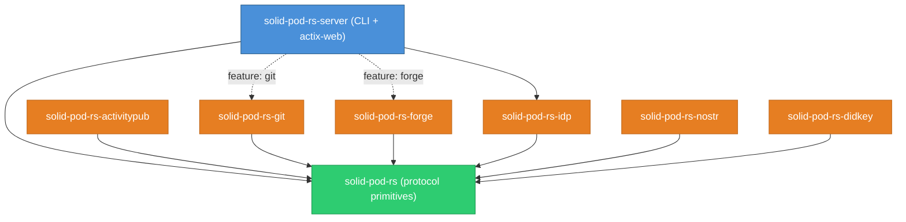

# solid-pod-rs

**A Rust Solid pod server and library workspace, ported from Melvin Carvalho's JavaScriptSolidServer.** Store resources over HTTP, control access with WAC, authenticate with Nostr or Solid-OIDC, and add provenance, payments or a git forge through explicit features.

[Start](#quick-start) · [Architecture](#architecture) · [Capabilities](#what-it-does) · [Status](#working-status) · [Docs](crates/solid-pod-rs/docs/README.md)

[](./LICENSE)
[](https://crates.io/crates/solid-pod-rs)
[](https://docs.rs/solid-pod-rs)
[](https://github.com/DreamLab-AI/solid-pod-rs/actions/workflows/ci.yml)
[](https://releases.rs/docs/1.88.0/)

**Maintainer**: [John O'Hare](https://github.com/jjohare) · **Upstream IP**: [Melvin Carvalho](https://github.com/melvincarvalho) ([JSS](https://github.com/JavaScriptSolidServer/JavaScriptSolidServer), the AGPL-3.0 reference Solid pod server) · [MAINTAINERS.md](MAINTAINERS.md)

New to Solid, RDF/JSON-LD, WAC, or did:nostr? The concepts live in one place: the [Solid primer for Rust developers](crates/solid-pod-rs/docs/explanation/solid-primer.md). This README stays on what solid-pod-rs is and where it sits.

## Where it sits in VisionFlow

solid-pod-rs owns storage and access-control primitives in the [VisionFlow estate](https://github.com/DreamLab-AI/VisionFlow). It can run independently or be embedded by a consumer. A pod authenticates and authorises requests; ontology consistency is the responsibility of the knowledge tools and their configured write paths, not an automatic property of pod storage.

| Consumer | Integration boundary |
|---|---|
| [Agentbox](https://github.com/DreamLab-AI/agentbox) | Builds a native server and configures identity, storage and optional forge services. Check its source pin and running image separately. |
| [VisionClaw](https://github.com/DreamLab-AI/VisionClaw) | Embeds pod-library functionality behind its own handlers. A library upgrade does not install the standalone server's routes or forge. |
| [nostr-rust-forum](https://github.com/DreamLab-AI/nostr-rust-forum) | Uses a Worker-compatible tier with different storage and process constraints; native git services are not available there. |

A shared `did:nostr` identifier can name a caller across services, but every consumer still has to enforce its own verification, ACLs, replay policy and key custody. See [ecosystem integration](crates/solid-pod-rs/docs/explanation/ecosystem-integration.md) and the [estate compatibility matrix](https://github.com/DreamLab-AI/VisionFlow/blob/main/docs/architecture/compatibility-matrix.md).

## Architecture

solid-pod-rs is a Cargo workspace of **8 crates**. The core library is framework-agnostic; sibling crates add bounded-context features and depend only on the core.

| Crate | docs.rs | Description |
|-------|---------|-------------|
| [`solid-pod-rs`](https://crates.io/crates/solid-pod-rs) | [](https://docs.rs/solid-pod-rs) | Core library — LDP, WAC, WebID, auth, provenance, payments, notifications, storage |
| [`solid-pod-rs-server`](https://crates.io/crates/solid-pod-rs-server) | [](https://docs.rs/solid-pod-rs-server) | Drop-in server binary (actix-web + CLI) |
| [`solid-pod-rs-idp`](https://crates.io/crates/solid-pod-rs-idp) | [](https://docs.rs/solid-pod-rs-idp) | Solid-OIDC identity provider |
| [`solid-pod-rs-activitypub`](https://crates.io/crates/solid-pod-rs-activitypub) | [](https://docs.rs/solid-pod-rs-activitypub) | ActivityPub federation + HTTP Signatures |
| [`solid-pod-rs-nostr`](https://crates.io/crates/solid-pod-rs-nostr) | [](https://docs.rs/solid-pod-rs-nostr) | did:nostr resolver + NIP-01 relay |
| [`solid-pod-rs-git`](https://crates.io/crates/solid-pod-rs-git) | [](https://docs.rs/solid-pod-rs-git) | Git HTTP smart-protocol backend (git-marks) |
| [`solid-pod-rs-forge`](https://crates.io/crates/solid-pod-rs-forge) | [](https://docs.rs/solid-pod-rs-forge) | Pod-native git forge — hosting, browse, issues, pull requests, merges, editing and optional discovery/mirroring |
| [`solid-pod-rs-didkey`](https://crates.io/crates/solid-pod-rs-didkey) | [](https://docs.rs/solid-pod-rs-didkey) | did:key + self-signed JWT verifier |



---

## Quick start

### As a server binary

```bash
cargo install solid-pod-rs-server

# Minimal config — one JSON file.
cat > config.json <<'EOF'
{
  "server": { "host": "127.0.0.1", "port": 3000 },
  "storage": { "type": "fs", "root": "./pod-root" },
  "auth":    { "nip98_enabled": true }
}
EOF

solid-pod-rs-server --config config.json
```

This starts the process, not an anonymous writable pod. With WAC enforced, an unsigned `curl PUT` is not a successful first write. Set up a caller and ACL using [Adding access control](crates/solid-pod-rs/docs/tutorials/03-adding-access-control.md), then use [request-bound NIP-98 authentication](crates/solid-pod-rs/docs/how-to/configure-nip98-auth.md) or [Solid-OIDC](crates/solid-pod-rs/docs/how-to/enable-solid-oidc.md).

For an authorised caller, the resource workflow is **PUT a Turtle document → GET it back → inspect ETag, content type and provenance receipt**. A write response and a confirmed external anchor establish different things. Behind a TLS-terminating proxy, configure the public origin or the documented proxy policy so the signed request URL matches the server's canonical URL.

The default server feature set excludes native git and forge. To build the full forge service explicitly:

```bash
cargo install solid-pod-rs-server --version 0.5.0-alpha.17 --features forge-full
```

Relay publication, mirror follow lists, anchoring and private/open-edit behaviour still require their own configuration. Consult [the release changes](CHANGELOG.md) before enabling them.

### As a library

```toml
[dependencies]
solid-pod-rs = { version = "0.5.0-alpha.17", features = ["fs-backend", "oidc"] }
```

```rust,no_run
use solid_pod_rs::storage::fs::FsBackend;
use std::path::PathBuf;

let storage = FsBackend::new(PathBuf::from("./pod-root"));
// Wire your HTTP framework of choice; see examples/embed_in_actix.rs.
```

Configuration layers combine defaults, a configuration file, environment variables and CLI overrides. The supported JSS-compatible names and Rust-specific options are enumerated rather than assumed interchangeable. See [`env-vars.md`](crates/solid-pod-rs/docs/reference/env-vars.md) for the full list.

---

## What it does

The core is framework-independent. The native server composes these capabilities; embedded and Worker consumers select a narrower feature set.

<details>
<summary><strong>Storage, identity, provenance and federation capabilities</strong></summary>

**LDP — Linked Data Platform.** Every URL is a resource (a file with RDF metadata) or a container (a directory that lists its children), addressed with standard HTTP verbs plus `COPY` and glob `GET`. Content negotiation over Turtle / JSON-LD / N-Triples, N3-Patch and SPARQL-Update PATCH, strong SHA-256 ETags, `Prefer` and `Range` headers, and `.meta` sidecars. Modules: `ldp`, `storage::*`.

**WAC — Web Access Control.** Deny by default: no ACL means no access. `.acl` sidecars specify who (by WebID, agent class, or group) may Read / Write / Append / Control, inheriting down the container tree via `acl:default`. Parser bounds cap Turtle at 1 MiB and JSON-LD depth at 32 levels (CWE-400). See [`wac-modes.md`](crates/solid-pod-rs/docs/reference/wac-modes.md) and [`debug-acl-denials.md`](crates/solid-pod-rs/docs/how-to/debug-acl-denials.md).

**Provenance & trust ledger.** With the native server’s `git` feature enabled, eligible writes attempt a local git-mark. A default server build records no git marks. The typed receipt distinguishes a skipped write, stored bytes without a successful mark, a local committed mark, an anchor submitted and an anchor confirmed. A successful resource write does not guarantee successful provenance, and a local commit is rewritable by its operator. **block-trails** add an optional Bitcoin anchoring tier; confirmation must be observed separately. Default network is `testnet4`; mainnet is an explicit operator choice. See [ADR-2004](crates/solid-pod-rs/docs/adr/ADR-2004-provenance-off-by-default.md) and the [provenance upgrade master plan](crates/solid-pod-rs/docs/design/provenance-upgrade-master-plan.md).

**Payments & web ledger.** solid-pod-rs inherits JSS's HTTP-402 economy: a `PaymentCondition` in a WAC ACL gates a resource behind a price, the client pays, the read succeeds. Settlement is sovereign and Bitcoin-native (sats, no EVM), sharing one verified taproot core with block-trail anchors — deposits, withdrawals, a routed order book and constant-product AMM, all through `PaymentStore` as the sole ledger I/O path, with replay protection on every settlement proof.

**Authentication.** Two paths, one `AuthContext`. **NIP-98** binds the complete request URL, method, and raw-body hash in a signed kind-27235 Nostr event. **Solid-OIDC** uses the authorisation-code flow with PKCE and DPoP-bound tokens (RFC 9449) for interoperability with existing Solid clients. The bundled server also supports JSS-compatible HMAC development bearer tokens when an explicit `TOKEN_SECRET` of at least 32 bytes is configured. See [`configure-nip98-auth.md`](crates/solid-pod-rs/docs/how-to/configure-nip98-auth.md) and [`enable-solid-oidc.md`](crates/solid-pod-rs/docs/how-to/enable-solid-oidc.md).

**Identity provider.** The `solid-pod-rs-idp` crate is a self-contained Solid-OIDC IdP — authorisation-code flow with PKCE, ES256-signed DPoP tokens, dynamic client registration, JWKS publication, WebAuthn passkeys, and NIP-07 Schnorr SSO — so a pod can run without a separate identity service.

**Federation.** `solid-pod-rs-activitypub` speaks ActivityPub (Actor discovery, HTTP-Signature inbox verification, follower fan-out, SQLite persistence). `solid-pod-rs-nostr` embeds a NIP-01 relay and resolves did:nostr. Solid Notifications 0.2 ships over WebSocket, webhook (RFC 9421 Ed25519-signed), and a legacy `solid-0.1` adapter. Reachable over three transports: Tailscale private mesh, the Nostr relay mesh, and Cloudflare tunnels.

**Storage.** A pluggable `Storage` trait backs everything. The shipped implementations are `fs-backend` (POSIX) and `memory-backend` (tests/demos). Unsupported backend names, including the removed dependency-only S3 scaffold, fail configuration validation. The filesystem backend uses capability-confined paths and atomic replacement writes. Per-pod quota uses `.quota.json` sidecars with process-wide atomic reservations.

**Security controls.** The workspace includes `..`/null-byte path rejection, SSRF filtering with IP pinning, ACL size caps, a dotfile allowlist, a NIP-98 token-size limit, and WAC-gated git smart-HTTP. The dated audit's findings are remediated (see the changelog for `0.5.0-alpha.13`). Supported filesystems: case-sensitive POSIX filesystems (ext4, xfs, btrfs, ZFS). Case-insensitive filesystems (default macOS/APFS, Windows/NTFS) are not a supported deployment target; the dotfile and well-known guards refuse case-variant spellings of guarded names, but nothing else is tested there. See [`security-model.md`](crates/solid-pod-rs/docs/explanation/security-model.md), the [2026-08-19 audit](crates/solid-pod-rs/docs/reference/security-audit-2026-08-19.md), and [`SECURITY.md`](crates/solid-pod-rs/SECURITY.md).

**Git forge.** `solid-pod-rs-forge` composes git hosting, browse, issues, forks, pull requests, real merges, editing and preview over the pod primitives. Native git and forge are default-off server features; `forge-full` includes anchoring, announce and mirror support. Real merges require git 2.38 or later. The operator configures relays and followed repositories.

</details>

---

## Documentation

Full documentation follows the [Diátaxis](https://diataxis.fr/) framework and lives at [`crates/solid-pod-rs/docs/`](crates/solid-pod-rs/docs/README.md) (the docs index) — tutorials, how-to guides, reference, and explanation. Parity and gaps are tracked row-by-row in [`PARITY-CHECKLIST.md`](crates/solid-pod-rs/PARITY-CHECKLIST.md) and narrated in [`GAP-ANALYSIS.md`](crates/solid-pod-rs/GAP-ANALYSIS.md).

---

## Working status

**Reviewed 21 October 2026 against `55bfec1`; workspace version `0.5.0-alpha.17`.** This is pre-1.0 software. The [changelog](CHANGELOG.md) records release-specific behaviour and remediation; the [parity checklist](crates/solid-pod-rs/PARITY-CHECKLIST.md) defines comparison scope.

| Area | Current source position | Boundary |
|---|---|---|
| Protocol parity | Checklist reports 99.2% strict over 264 rows, with partial rows remaining | Comparator is JSS `8d68ceb` / package 0.0.221 plus the separately bounded plugins/forge comparator `63a16cb`; not a universal conformance score |
| Forge | Alpha.17 implements the previously missing forge surface and mirror hardening | Compiled features, configured service and consumer activation remain separate |
| Provenance | Receipt stages describe how far marking and anchoring reached | A stored resource is not necessarily committed or confirmed; see [`provenance.rs`](crates/solid-pod-rs/src/provenance.rs) |
| Storage | Filesystem and memory implementations | Case-sensitive POSIX deployment target; no supported S3 backend |
| Security | Release notes and dated audit document fixed findings and remaining gaps | This README refresh did not rerun a security audit or establish current dependency-advisory status |
| Estate integration | Native server, embedded library and Worker tiers differ | A release of this workspace does not prove consumers have rebuilt or activated it |

Alpha.17 adds forge APIs, merges, edit/preview, discovery and mirror service wiring, invite redemption and public-origin controls. It also records fixes for cross-owner access, bounded git operations, resolver address pinning and invite handling. See [the release entry](CHANGELOG.md#050-alpha17--2026-10-20), [`deny.toml`](deny.toml), [advisory policy](.cargo/audit.toml) and [security reporting](crates/solid-pod-rs/SECURITY.md) for their respective scopes. Historical green checks are not a claim that today's whole workspace or deployment has passed those checks.

## Lineage & licence

solid-pod-rs is a Rust port of [JavaScriptSolidServer](https://github.com/JavaScriptSolidServer/JavaScriptSolidServer) and deliberately inherits JSS's AGPL-3.0 licence to preserve the ecosystem's network-service copyleft — the sovereignty mechanism, not an accident.

```
JavaScriptSolidServer (Node.js, AGPL-3.0)
        │  reference implementation, Melvin Carvalho
        ▼
solid-pod-rs (Rust, AGPL-3.0)   ← you are here
```

**AGPL-3.0-only.** If you operate solid-pod-rs as a network-accessible service — which, being a pod, you almost certainly will — §13 requires you to offer corresponding source to your users. See [`LICENSE`](LICENSE) and [`NOTICE`](crates/solid-pod-rs/NOTICE).

---

## Contributing

See [`CONTRIBUTING.md`](crates/solid-pod-rs/CONTRIBUTING.md). Run `cargo test --all-features` and `cargo clippy --all-targets --all-features -- -D warnings` before opening a pull request. Report security issues via [`SECURITY.md`](crates/solid-pod-rs/SECURITY.md). Maintainers: [MAINTAINERS.md](MAINTAINERS.md).
